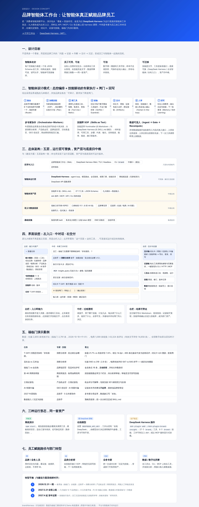
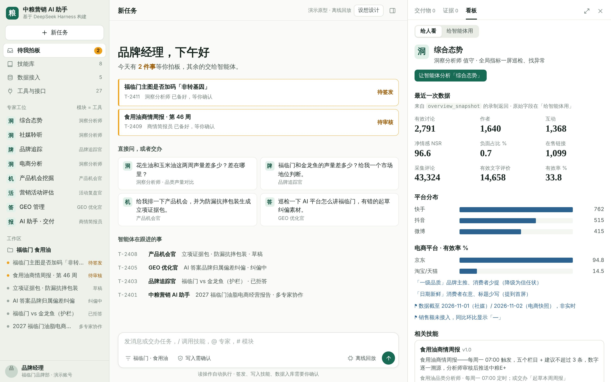

# 品牌智能体工作台 · 设想设计

> 可视化版本：工作台右上角「设想设计」，或直接打开 `apps/workbench/concept.html`。



## 1. 从「演示包」到「智能体工作形态」

| | 原洞察平台演示包 | 本次改造 |
|---|---|---|
| 主形态 | 7 个业务看板 + 离线回放的 3 段对话 | 三栏智能体工作台：左入口、中对话、右交付 |
| 九大模块 | 独立页面，给人看 | 左栏入口；同时是带 JSON Schema 的工具，供智能体、MCP、API、CLI 调用 |
| 智能体 | 回放，不连模型 | 离线规划器（真实调用工具）/ DeepSeek 在线 / DeepSeek Harness 插件 |
| 技能 | PPT 中的规划 | 8 份可运行的 SKILL.md，可在界面修订、沉淀新技能 |
| 数据 | 固定快照 | 批量导入 + 数据流推入，四道筛质检后即时参与计算 |
| 交付 | 结论卡截图 | 结论卡 / 周报 / 年报大纲 / 证据包 / 纠偏素材，可签发、导出、回写 |

## 2. 设计原则

1. **页面即工具**：每个模块能力都有工具身份（名称、说明、参数 Schema、结构化返回、口径说明）。人在页面上核对，智能体通过工具调用同一套数据和算法。
2. **技能即 SOP**：专家的工作方式写成文字（何时使用 / 可用工具 / 步骤 / 约束 / 输出），业务能读、能审、能改；与 DeepSeek Harness 的 `SKILL.md` 格式兼容。
3. **可信先于聪明**：每个数字都要能指回工具字段；样本不足就拒答；分母不混算；没有依据写「未知」。
4. **人在环**：签发、技能修订、数据入库三类写操作必须由人确认，全部留痕。
5. **一套资产、多种底座**：资产层（工具、技能、字典、数据）不绑定运行层，可迁移到任何支持工具 / MCP / 技能的智能体底座。

## 3. 智能体设计模式

综合采用以下成熟模式，按品牌业务「可审计」的要求组合：

```
员工提问
  │
  ▼
① Router 路由 ── 总助手判断属于 8 个业务场景中的哪一个 → 指派专家
  │
  ▼
② Skill/Plan ── 专家加载技能说明，按步骤生成执行计划（逐步打勾）
  │
  ▼
③ Tool Use ──── 调用九大模块工具（MCP / API），取数、取原文、算指标
  │                     ▲
  │                     └── 数据底座 ← 批量导入 / 数据流推入（四道筛）
  ▼
④ Verifier ──── 结论卡数字重放核对；对比类工具过覆盖门槛，不达标拒答
  │
  ▼
⑤ Artifacts ─── 结论卡、周报、证据包进入右栏，附证据链
  │
  ▼
⑥ HITL 人审 ─── 签发 / 技能写入 / 数据入库：人确认后才落盘，留 sha256 与审计记录
  │
  ▼
⑦ Writeback ─── 结论入洞察库；一次成功的分析「沉淀为技能」，下一次更准
```

- **多专家协作（Orchestrator–Workers）**：年度报告等复合任务由总助手拆成章节，分派给 5 位专家，由商情简报员汇编；对话里每个工具卡标注调用它的专家。
- **护栏（Guardrail）是工具的一部分**：`insight_compare` 自带覆盖门槛（社媒 ≥100、电商有效评价 ≥200），返回 `verdict=refuse` 时智能体必须拒答；`geo_fact_draft` 在事实证据未补齐时直接 `blocked`。
- **校验器（Verifier）不靠模型自觉**：`insight_compose` 由系统重放来源工具核对数字，溯源率 < 100% 的卡无法签发。

## 4. 专家家族与业务场景

| 专家 | 批次 | 主要场景 | 代表技能 |
|---|---|---|---|
| 中粮营销 AI 助手（总助手） | 入口 | 八个场景统一入口、调度、汇总、提交人审 | 食用油年度 AI 报告、数据接入质检 |
| 洞察分析师 | 一期 | 内容与种草、电商货架、口碑与风险 | 卖点错位诊断 |
| 产品机会官 | 一期 | 产品开发与改良、新品上市 | 立项证据包 |
| 商情简报员 | 一期 | 周报 / 月报 / 年报 | 食用油商情周报 |
| 品牌追踪官 | 全部上线 | 品牌心智与母子协同、口碑与风险 | 竞品对比护栏 |
| 活动复盘官 | 全部上线 | 活动与投放、内容与种草 | 活动全周期复盘 |
| GEO 优化官 | 全部上线 | AI 答案与品牌事实 | AI 答案纠偏 |

## 5. 界面设计

| 区域 | 内容 | 设计意图 |
|---|---|---|
界面只保留三块，常用的放在眼前，其余收进入口：

| 区域 | 内容 | 设计意图 |
|---|---|---|
| 左列 · 入口 | 待我拍板（数字 = 等你确认的事）、技能库、数据接入、工具与接口 | 先看要人做的事；资产和接口一点即开，不常驻 |
| 左列 · 专家工位 | 原九大业务模块，每个标出值守专家（洞察分析师、品牌追踪官……） | 模块 = 一组工具 = 一位专家的工位；点开即看板 |
| 左列 · 工作区 | 福临门 食用油的任务与状态 | 回到任务 |
| 中间 · 对话 | 五步闭环进度；按专家分段的对话；思考、计划、工具行（一行一个，可展开）、原文、表格、交付物条、拍板卡；底部是工作范围、写入需确认、运行模式和统计 | 过程透明、可追问；只在关键节点停下等人 |
| 右侧 · 交付物 | 结论卡、周报、年报大纲、立项证据包、纠偏素材、技能草稿；导出 / 复制 / 回写技能 / 确认写入 | 结果可带走、可审 |
| 右侧 · 证据 | 结论卡每个数字的出处；每次工具调用的完整返回，可复现为 CLI / HTTP / MCP | 可审计、可复现；分析师据此开发新分析 |
| 右侧 · 看板 | 模块看板（给人看 / 给智能体用）、技能库、数据接入、工具与接口 | 员工从「用」走到「改」和「开发」 |

配色只表达「谁在动」：智能体 = 绿，平台 / 工具 = 靛青，人 = 琥珀。琥珀只出现在需要人拍板的地方。



## 6. 运行形态

| 形态 | 启动 | 适用 |
|---|---|---|
| 离线演示 | `npm start` | 汇报、培训；规划器按技能步骤真实调用工具，模板组织语言 |
| 静态回放 | 打开 `apps/workbench/index.html` 或 GitHub Pages | 无 Node 环境；播放从真实运行录制的会话 |
| 在线模型 | `DEEPSEEK_API_KEY=… npm start`，切到「在线 DeepSeek」 | 模型自主决定调用顺序；工具与守则不变 |
| DeepSeek Harness | `dsh plugin --profile web add …/dsh-plugin-brand-insight` | 生产形态；内网部署、私有化模型、权限门禁、会话留痕 |

## 7. 代码结构

```
packages/
  brand-core/              算法层与资产层（单一真源）
    src/dataset.js         数据访问（基线 + 增量合并）
    src/social.js          社媒：声量、关键词、原文、口碑标签、对比（覆盖门槛）
    src/ecommerce.js       电商：有效评价、卖点错位、痛点、价格偏离
    src/modules.js         机会评分、品牌健康度、预警、活动、GEO、字典
    src/report.js          结论卡溯源、签发闸门、周报 / 年报起草
    src/ingest.js          批量导入 / 流式推入 / 四道筛
    src/skills.js          技能库（SKILL.md 读写与版本）
    src/tools.js           27 个工具的注册表
    src/agent/planner.js   离线智能体（11 个场景）
    src/agent/deepseek.js  在线智能体（DeepSeek 函数调用）
  brand-server/            HTTP API + SSE + 静态工作台
  brand-mcp/               MCP stdio 服务
  brand-cli/               命令行 brand
  dsh-plugin-brand-insight/ DeepSeek Harness 组合包
apps/workbench/            工作台前端（无构建）+ 设想设计页 + 回放数据
skills/                    8 份专家技能说明
data/fulinmen/             福临门脱敏数据集与演示参考数据
tests/                     单元 / 端到端 / 浏览器 / 真实 dsh 验证
```
