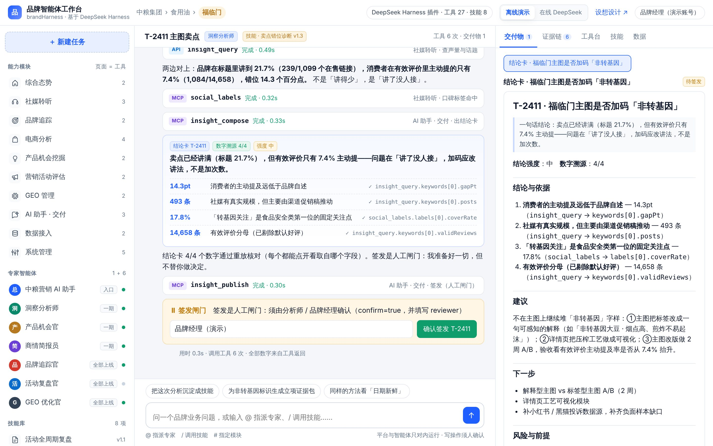
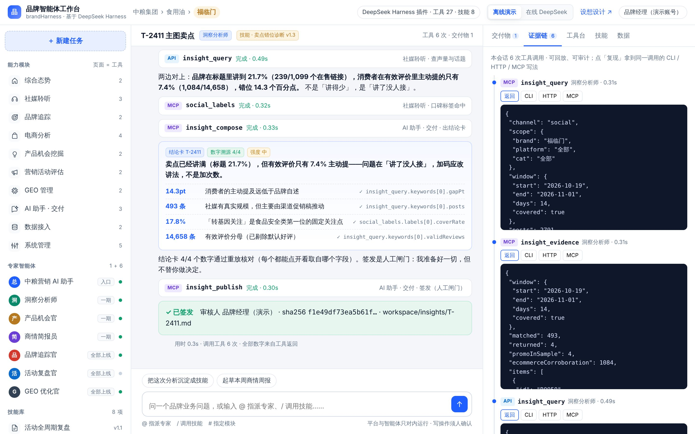
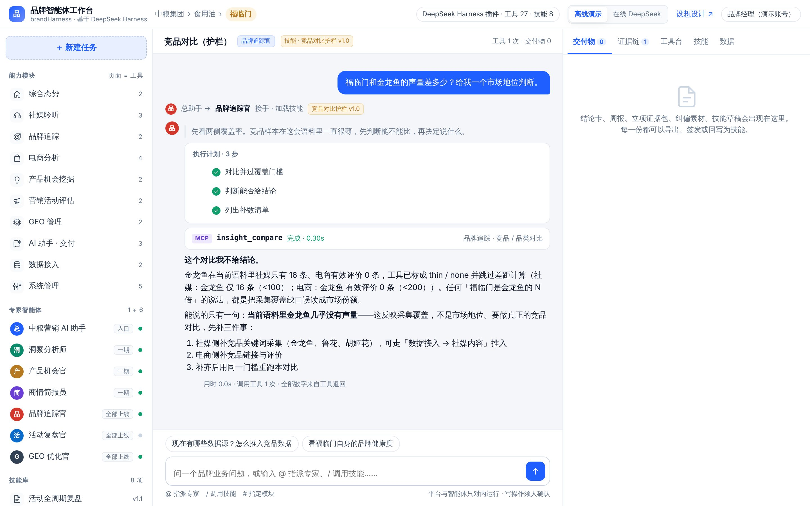
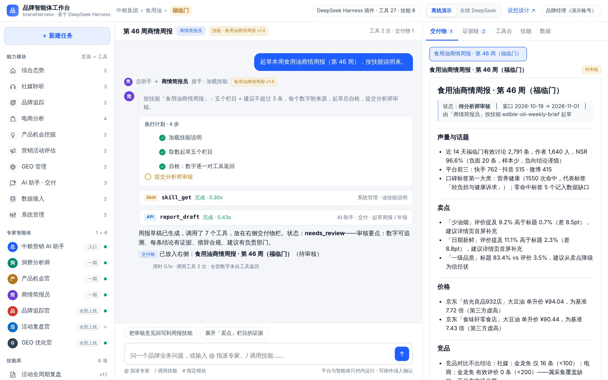
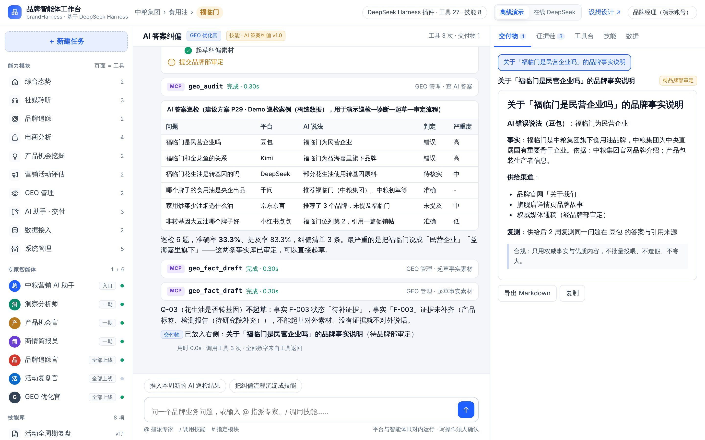
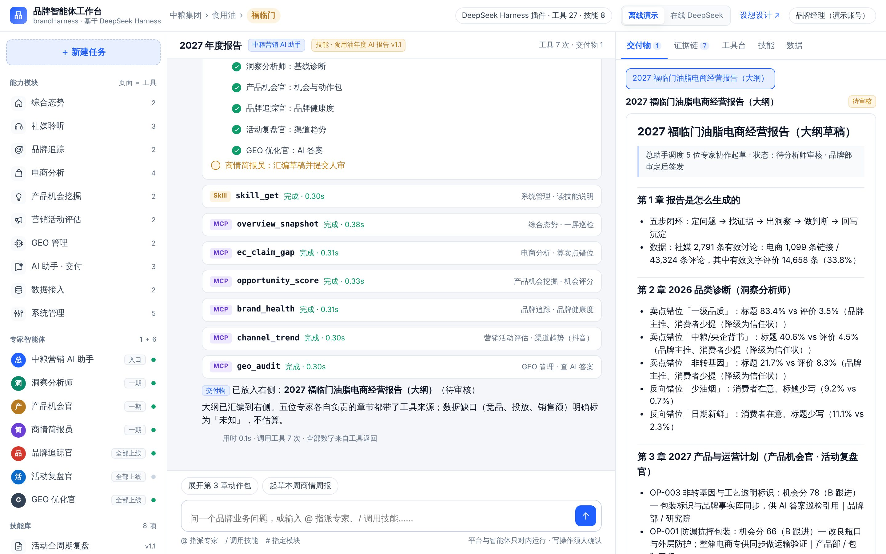
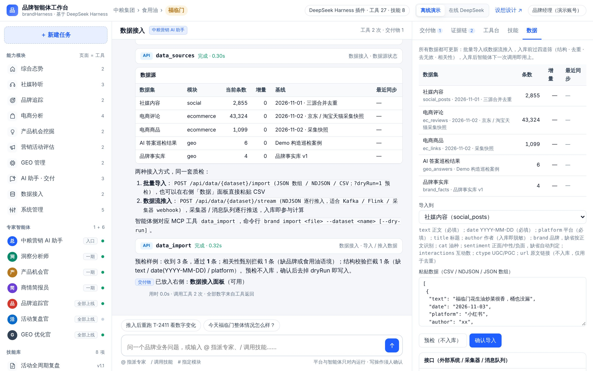
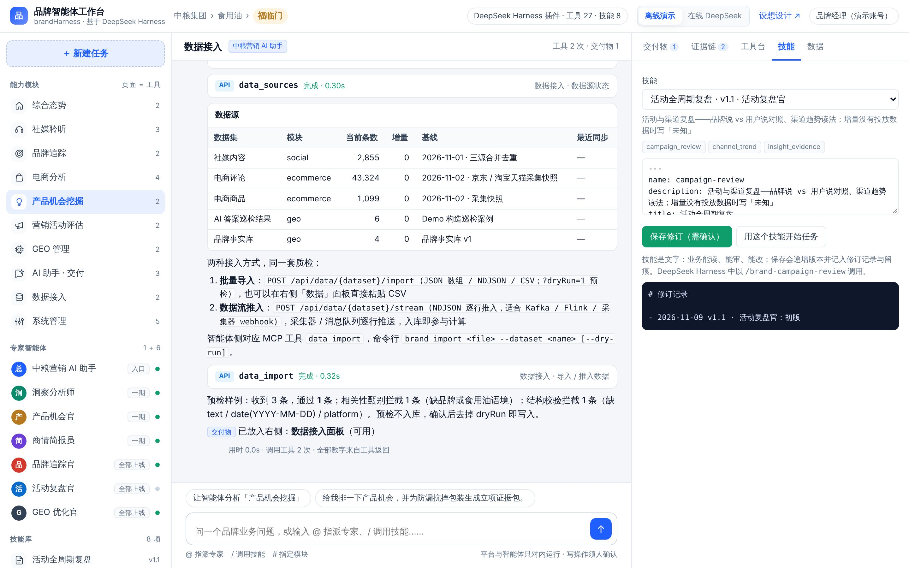

# 产品功能 Demo 说明（福临门演示案例）

## 0. 打开方式

```bash
npm install && npm start
```

浏览器打开 `http://127.0.0.1:8787`。无需联网、无需模型密钥；所有数字由算法层对真实采集样本实时计算。

**数据范围**（界面与结论卡中均会说明）：

| 数据 | 规模 | 口径 |
|---|---|---|
| 社媒 | 原始 71,881 条 → 去重 15,376 → 有效 2,855 条（福临门 2,791 条） | 三源合并（社交平台 / 网页资讯 / 客户端）、跨源去重、相关性过滤；窗口 2026-10-19 → 11-01；作者已脱敏 |
| 电商 | 1,099 条在售链接、43,324 条评论（有效文字评价 14,658 条） | 京东 + 淘宝天猫采集快照 2026-11-02；剔除默认好评 |
| 口碑标签 | 8 类 44 项 | 消费者口碑标签体系 V1.1 |
| AI 答案巡检 / 抖音趋势 | 6 题 / 10 个月 | 建设方案 Demo 构造案例 / 《福临门-抖音趋势分析》区间口径，界面标注来源 |

## 1. 十分钟演示路线

| 时间 | 操作 | 讲什么 |
|---|---|---|
| 0:00 | 首页 | 左栏是原九大模块，现在是入口也是工具；中间对话、右边交付 |
| 0:40 | 点「T-2411 主图卖点」 | 总助手 → 洞察分析师接手、加载技能「卖点错位诊断 v1.3」、列出 6 步计划 |
| 1:30 | 点开 `insight_query` 工具卡 | 参数、返回、口径说明；493 条命中多为促销话术 |
| 2:30 | 看结论卡 | 标题 21.7% vs 有效评价 7.4%，错位 14.3pt；4 个数字都标了来源字段、通过重放核对 |
| 3:15 | 签发闸门 → 确认签发 | 写盘、sha256、留痕；智能体不替人做决定 |
| 3:45 | 右栏「证据链」→ CLI / HTTP / MCP | 同一调用三种复现方式，分析师可以拿去开发 |
| 4:30 | 点建议「把这次分析沉淀成技能」 | 按本次实际工具链起草 SKILL.md → 确认写入 → 左栏技能库 +1 |
| 5:30 | 任务「福临门 vs 金龙鱼」 | 金龙鱼仅 16 条，**主动拒答**并给补数路径 |
| 6:15 | 任务「第 46 周商情周报」 | 商情简报员按技能起草五个栏目，待审核；审核意见可回写技能 |
| 7:15 | 任务「2027 年度报告」 | 总助手调度 5 位专家，工具卡标注是谁调用的 |
| 8:15 | 任务「数据接入」→ 右栏「数据」 | 粘贴一条小红书笔记 → 预检 → 导入 → 条数 +1；接口可接采集器与消息队列 |
| 9:15 | 左栏「产品机会挖掘」→ 工具台 | 页面 = 工具：直接运行 `opportunity_pack` |

## 2. 功能清单

### 2.1 左栏：能力与资产

- **能力模块（10）**：综合态势、社媒聆听、品牌追踪、电商分析、产品机会挖掘、营销活动评估、GEO 管理、AI 助手·交付、数据接入、系统管理。数字为该模块的工具数，悬停显示工具名；点击 → 右栏工具台切到该模块，并给出「让智能体分析该模块」的快捷追问。
- **专家智能体（1 + 6）**：在线状态、上线批次；点击把专家 @ 到输入框。
- **技能库（8）**：名称、版本；点击打开技能全文与修订记录。
- **任务**：T-2411 待签发、T-2409 待审核……点击重跑该任务。

### 2.2 中栏：专家工作对话

| 元素 | 说明 |
|---|---|
| 专家接手条 | 「总助手 → 洞察分析师 接手 · 加载技能 卖点错位诊断 v1.3」 |
| 执行计划 | 技能步骤展开为计划，执行中逐步打勾，等待人确认的步骤标黄 |
| 工具卡 | 传输方式（MCP / API / Skill / Function）、工具名、模块·功能、耗时、调用专家；展开看参数与返回摘要、口径说明 |
| 原文证据 | 平台、日期、情感、互动、是否促销话术 |
| 表格 / 图表 / 指标卡 | 平台差距、机会排序、巡检结果、日声量、抖音环比 |
| 结论卡 | 一句话结论、强度、数字溯源 n/n、每条依据的来源字段 |
| 签发闸门 | 填审核人 → 确认签发 → 写盘、sha256、留痕 |
| 建议追问 | 每个任务结束给出下一步 |
| 输入 | `@专家` 指派、`/技能` 调用、`#模块` 限定；Enter 发送 |

### 2.3 右栏

| 标签 | 功能 |
|---|---|
| 交付物 | 结论卡、周报、年报大纲、立项证据包、纠偏素材、技能草稿；导出 Markdown、复制、签发、把审核意见回写技能、技能草稿确认写入 |
| 证据链 | 本会话每次工具调用的完整返回；一键切换为 CLI / HTTP / MCP 调用写法 |
| 工具台 | 按模块选择工具、编辑参数、运行，看 Schema 与结构化返回 |
| 技能 | 阅读、修订（自动递增版本）、查看修订记录；「用这个技能开始任务」 |
| 数据 | 数据源条数 / 增量 / 最近同步；粘贴 CSV / NDJSON / JSON 预检或导入；接口说明 |

## 3. 演示场景详解

### 3.1 T-2411 福临门主图是否加码「非转基因」（洞察分析师 · 卖点错位诊断）



工具链：`insight_query`（社媒）→ `insight_evidence` → `insight_query`（电商）→ `social_labels` → `insight_compose` → `insight_publish`。

关键数字（全部实时计算）：社媒近 14 天福临门 2,791 条，「非转基因」命中 493 条（17.7%）、作者 309 人、头号平台快手 212 条；电商标题提及 239/1,099（21.7%），有效评价主动提及 1,084/14,658（7.4%），错位 **14.3pt**；口碑标签「转基因关注」覆盖 17.8%。结论：讲了没人接，改讲法而不是加次数；主图 A/B 的验收指标看有效评价主动提及率。

签发后：



### 3.2 花生油 vs 玉米油（洞察分析师）

社媒 940 vs 319（2.9 倍），电商有效评价 647 vs 645 持平 → 差距在传播面；今日头条 146 vs 4、百家号 124 vs 11 为结构性空白。

### 3.3 福临门 vs 金龙鱼（品牌追踪官 · 竞品对比护栏）



金龙鱼社媒 16 条、电商 0 条，`insight_compare` 返回 `verdict=refuse`，智能体拒答并给出补数路径（可走数据接入推入竞品数据）。

### 3.4 第 46 周商情周报（商情简报员 · 食用油商情周报）



按技能取数起草：声量与话题、卖点（反向错位：少油烟 9.2% vs 0.7%、日期新鲜 11.1% vs 2.3%）、价格（第三方单升价虚高 7.7 倍）、竞品（不出结论）、风险与 AI 答案、本周建议 ≤3 条，附证据附录与审核要点；草稿保存到 `workspace/reports/W-46.md`。

### 3.5 立项证据包（产品机会官）

机会评分（KSPEC-PI-01，可解释的三项分）；为「防漏抗摔包装」生成证据包：包装负面评价 301 条原文、390 条「没有漏油 / 包装完好」反例（提示问题集中在部分渠道与物流）、负责部门、验证计划。

### 3.6 AI 答案纠偏（GEO 优化官）



6 题巡检、准确率与纠偏清单；为 Q-01「福临门是民营企业吗」起草事实素材（待品牌部审定）；Q-03「花生油是否转基因」因事实证据未补齐 **不起草**。

### 3.7 活动与渠道复盘（活动复盘官）

品牌说 vs 用户说：「一级品质」标题 83.4%，评价只 3.5%（采纳率 0.04）；「少油烟」采纳率 13.1。抖音 1–10 月环比波动未收敛，不叫稳定增长；增量评估因投放数据未接入写「未知」。

### 3.8 2027 年度报告（总助手 · 多专家协作）



总助手加载「食用油年度 AI 报告 v1.1」，分派 5 位专家各取所需工具，汇编 5 章大纲；数据缺口（竞品、投放、销售额）标为未知。

### 3.9 数据接入（总助手 · 数据接入质检）



查看 5 个数据集状态；预检样例：3 条进 1 条，「相关性甄别」「结构校验」各拦 1 条；确认后导入，下一次工具调用即用上新数据。

### 3.10 沉淀为技能（总助手）

在任一分析后点「把这次分析沉淀成技能」：按上一次实际调用的工具链起草 `SKILL.md`（frontmatter + 何时使用 / 工具 / 步骤 / 约束 / 输出），右栏可直接改，确认后写入技能库并记录修订人。



### 3.11 一屏巡检（总助手）

社媒 / 电商核心指标、日声量图、预警（2026-10-30 声量 272 条，z=2.74），并给出分派建议。

## 4. 员工怎么用起来

| 角色 | 第一周 | 第一个月 |
|---|---|---|
| 品牌经理 | 用对话交办 T-2411 这类问题，审结论卡、签发 | 把常问问题沉淀成自己的技能 |
| 品类分析师 | 审周报、把修改意见回写技能 | 维护本品类的技能版本与口径 |
| 数据 / 数字化 | 在工具台和 CLI 复现证据链；把采集器接到 `/stream` | 新增工具（在 `brand-core/tools.js` 注册一次，五个表面同时可用） |
| 管理者 | 看签发留痕与技能修订记录 | 用技能库规模、溯源率、审核用时评估转型进度 |

## 5. 边界说明

- 平台与智能体只对内运行；对外内容（AI 答案素材等）须品牌部审定。
- 离线模式的文字由模板组织，数字全部来自工具；在线模式由 DeepSeek 组织语言，守则与工具不变。
- 销售额、投放花费、竞品电商数据未接入，相关结论一律写「未知」。
- GEO 巡检与抖音趋势为方案中的 Demo 构造 / 摘录数据，界面已标注来源。
